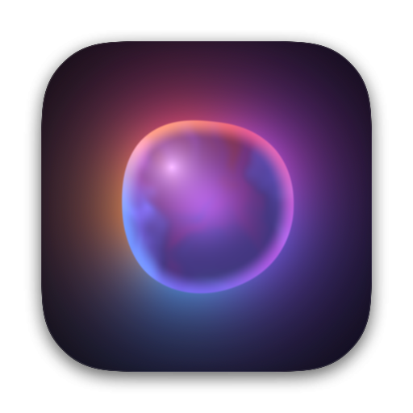
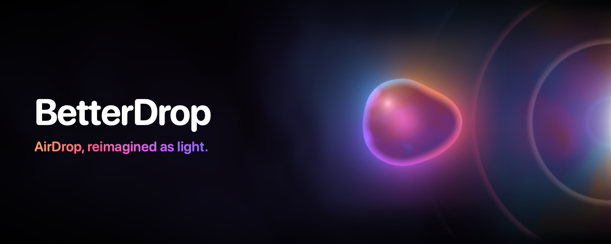
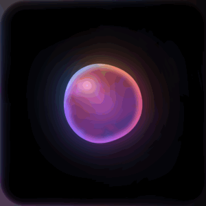
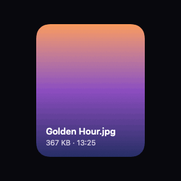
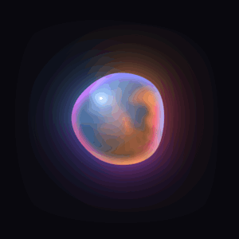
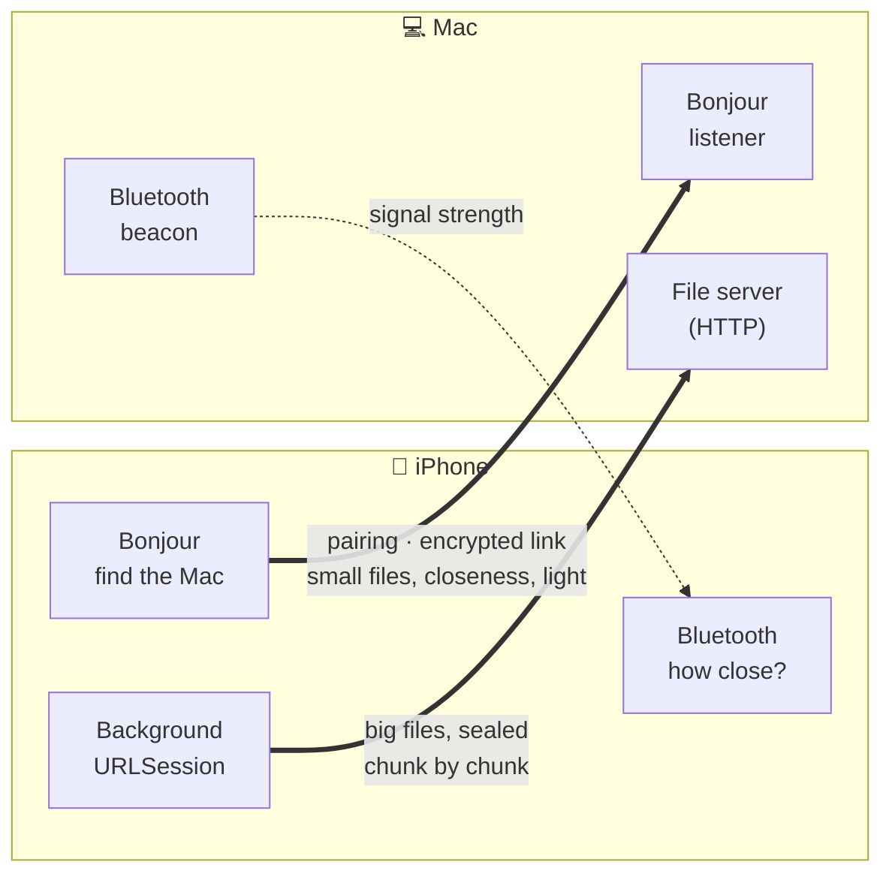

<div align="center">



# BetterDrop

### AirDrop, reimagined as light.

Hold your iPhone against your Mac. A drop of light wakes up and reaches for it.<br>
Throw a photo off your screen, and it bursts out of the side of your Mac.

[](#-get-it-running)
[](#-get-it-running)
[](#-the-light)
[](#-privacy-and-security)
[](#-contributing)
[](LICENSE)
[](https://github.com/Pallepadehat/BetterDrop/actions/workflows/ci.yml)

<br>



<br>

**[Get it running](#-get-it-running)** · **[What it does](#-what-it-does)** · **[The light](#-the-light)** · **[Privacy and security](#-privacy-and-security)** · **[How it works](#-how-it-works)** · **[Contributing](#-contributing)**

<br>

<a href="https://buymeacoffee.com/patrickjakobsen"></a>

</div>

<br>

## ✦ What it does

BetterDrop moves photos, videos and any other file between your iPhone and your Mac. It goes straight from one to the other, encrypted, with no cloud and no account. It's also made to feel like something: everything you see on screen is light, drawn on the GPU.

<table>
<tr>
<td width="50%" align="center"></td>
<td width="50%" align="center"></td>
</tr>
<tr>
<td valign="top"><b>It knows how close you are</b><br>Bring your iPhone to your Mac and the orb wakes up, brightens and stretches towards it. The edge of the phone's screen lights up on the Mac's side. Soft taps under your thumb tell you you're getting closer.</td>
<td valign="top"><b>And so does the Mac</b><br>Light flows out of the side of the Mac's screen where the phone is, and grows as the phone comes closer. While files move, rings roll out of the edge.</td>
</tr>
<tr>
<td width="50%" align="center"></td>
<td width="50%" align="center"></td>
</tr>
<tr>
<td valign="top"><b>Throw it</b><br>Hold a card for a moment and it lifts off the grid, tilting as you move it. Throw it and it burns into light as it flies off. On the Mac it comes out of the light at the screen edge, floats so you can see it, and drifts up to the menu bar.</td>
<td valign="top"><b>Hold the light to connect</b><br>The first time, press and hold the orb. It charges up with a rising patter of haptics, then bursts into a ripple. Both screens show the same six digits; click Accept on the Mac. After that they find each other by themselves.</td>
</tr>
</table>

- 📸 **Anything.** Photos and videos from your library, files from the Files app, whatever's on the clipboard, or any file you drag on the Mac.
- 🪟 **Drag it to the edge.** On the Mac, drag files onto the side of the screen where the phone is, or onto the menu bar panel. They fly to the phone.
- 🌙 **Big files keep going.** Anything over 8 MB goes in the background, so you can leave the app, lock the phone or put it in your pocket.
- 🗂 **Your files, where you'd look.** On the Mac they land in `~/Downloads/BetterDrop`. On the iPhone they're in the Files app too, under *On My iPhone → BetterDrop*. Save pictures and videos to Photos with one tap.
- 🔄 **Keeps itself up to date.** The Mac app checks GitHub once a day and updates itself.

<br>

## 🚀 Get it running

You need an **iPhone on iOS 26** and a **Mac on macOS 26** or later, on the same Wi-Fi. They can also talk directly, peer-to-peer, like AirDrop does.

### The Mac app

Paste this into Terminal:

```sh
curl -fsSL https://raw.githubusercontent.com/Pallepadehat/BetterDrop/main/install.sh | bash
```

It downloads the latest release, puts BetterDrop in your Applications folder (replacing an older copy) and opens it. BetterDrop lives in your menu bar. After that it keeps itself up to date.

<details>
<summary><b>Or use the .dmg</b></summary>
<br>

Download **BetterDrop.dmg** from the [latest release](https://github.com/Pallepadehat/BetterDrop/releases/latest), open it and drag BetterDrop into Applications.

Releases aren't notarized by Apple yet, so the first time, macOS says it can't check BetterDrop for malware. Click **Done**, then open **System Settings → Privacy & Security**, scroll down and click **Open Anyway**. Or run:

```sh
xattr -dr com.apple.quarantine /Applications/BetterDrop.app
```

The install script does this for you. It's [short and readable](install.sh), if you'd like to check it first.

</details>

### The iPhone app

There's no App Store version yet. Two ways to put it on your phone, both free:

- **With Xcode** (recommended): clone the repo, `open BetterDrop.xcodeproj`, pick the **BetterDrop iOS** scheme and your iPhone, choose your Apple ID as the team under *Signing & Capabilities*, and press **⌘R**. A free Apple ID works; the app then has to be reinstalled every seven days.
- **With a sideloading tool**: download **BetterDrop.ipa** from the [latest release](https://github.com/Pallepadehat/BetterDrop/releases/latest) and install it with [AltStore](https://altstore.io) or [Sideloadly](https://sideloadly.io), which sign it with your Apple ID.

### First connection

1. Open BetterDrop on the Mac. It's the drop in the menu bar.
2. Open BetterDrop on the iPhone and allow **Local Network** and **Bluetooth**.
3. Hold the phone against the **right** side of the Mac's screen (or the left: Settings → *Your iPhone sits on the*).
4. Press and hold the light. Check the code matches, and click **Accept** on the Mac.

<details>
<summary><b>Which permissions does it ask for, and why?</b></summary>
<br>

| Permission | Where | What for |
| --- | --- | --- |
| **Local Network** | both | Finding each other and sending files on your network |
| **Bluetooth** | both | Telling how close the phone is to the Mac. Nothing is sent over Bluetooth |
| **Photos (add only)** | iPhone | *Save to Photos*, when you ask |

Bluetooth is optional. Without it, everything still works; you just don't get the light that follows the phone.

</details>

> [!NOTE]
> The project ships with the bundle ID `com.patrickjakobsen.betterdrop` and the maintainer's team ID. To sign your own copy, change both in `project.yml` (or in Xcode under **Signing & Capabilities**).

<br>

## ✨ The light

Every effect in BetterDrop is a **Metal shader**, one GPU pass each, in a single file: [`Light.metal`](Packages/BetterDropKit/Sources/BetterDropUI/Shaders/Light.metal). There are no stacks of blurred layers, so it stays smooth and cheap. Effects pause when nothing moves and draw nothing at all when they're off. The Mac's overlay leaves the screen entirely when it's dark.

| Shader | What it draws |
| --- | --- |
| `Orb` | The drop of liquid light: domain-warped noise in a pearl palette, a glassy rim and a highlight. It stretches towards a point with a smooth-min metaball and swirls faster while you hold it |
| `EdgeGlow` | Light hugging the rounded edge of the phone's screen, leaning to the Mac's side, flaring on arrivals |
| `Portal` | The curtain of light out of the Mac's screen edge, with sonar rings and a front of light for every file |
| `Dissolve` | Burns a card into light from the side it's flying towards, or condenses it back |
| `Ripple` | A ring of displacement, for the burst when you connect and the pulses while touching |
| `Plasma`, `Aurora` | Flowing light inside incoming cards, and a dark aurora behind the connect screen |

The pictures in this README are drawn by those same shaders: `./scripts/make-brand.sh` renders the app icons, the banner and every GIF. Reduce Motion slows everything right down.

<br>

## 🔒 Privacy and security

- ✅ **Straight between your devices.** No server, no cloud, no account, no analytics. The only other traffic is the Mac app's daily look at GitHub for an update, and you can turn that off.
- ✅ **Only devices you paired.** Pairing is an X25519 key exchange confirmed with a six-digit code on both screens, which rules out anyone in the middle.
- ✅ **Encrypted end to end.** Every connection proves both sides hold the pairing secret and agrees fresh keys (forward secrecy). Every record is sealed with ChaCha20-Poly1305, and replayed, reordered or tampered data ends the connection.
- ✅ **Checked on arrival.** Files are verified with SHA-256, or chunk by chunk when they come in the background, before they count as arrived. Names are sanitized so nothing can land outside its folder.
- ✅ **Bluetooth carries nothing.** It's a lighthouse the phone measures, not a channel.

The full design is in **[docs/PROTOCOL.md](docs/PROTOCOL.md)**, and the known limits are in **[SECURITY.md](SECURITY.md)**. Found a hole? Please [report it privately](https://github.com/Pallepadehat/BetterDrop/security/advisories/new).

<br>

## 🧠 How it works



It's one monorepo: a Swift package both apps share, and two thin apps on top.

```
Packages/BetterDropKit/          everything both apps share
  BetterDropCore                 models, the library, the wire format, the crypto (pairing, sessions, FileCipher)
  BetterDropTransport            Bonjour, Bluetooth proximity, the encrypted link, background transfers, the file server
  BetterDropUI                   the shaders and the views: the orb, the glow, the portal, cards and the grid
Apps/iOS/                        the iPhone app
Apps/macOS/                      the Mac app: menu bar panel, the light at the screen edge, Sparkle updates
scripts/                         build, release and brand scripts
```

<br>

## 🛠 Contributing

New effects, smoother gestures, more file types and fixes are all very welcome. See **[CONTRIBUTING.md](CONTRIBUTING.md)**.

- Run the tests with `swift test --package-path Packages/BetterDropKit`. They cover the crypto (including a man in the middle), the wire format, file names, the library, and real transfers both ways over localhost, live and in the background.
- The Xcode project is generated from `project.yml` with [XcodeGen](https://github.com/yonaskolb/XcodeGen): run `xcodegen generate` after adding files.
- Try things without tapping: in debug builds, run with `BETTERDROP_DEMO=pair,send` on the iPhone and `BETTERDROP_DEMO=accept,send` on the Mac.

### Making a release

Bump `MARKETING_VERSION` in `project.yml`, commit, and run:

```sh
./scripts/release.sh
```

It builds `BetterDrop.dmg` (the Mac app, signed ad hoc) and `BetterDrop.ipa` (the iPhone app, unsigned, for sideloading), signs `appcast.xml` with the Sparkle key, tags the commit and publishes a GitHub release. The install script downloads the newest disk image; the Mac app finds new versions through the appcast ([Sparkle](https://sparkle-project.org)).

There's no Apple Developer ID behind BetterDrop yet, so what proves an update is genuine is Sparkle's **EdDSA signature**. It's made with a private key in the maintainer's keychain (account `betterdrop`), and its public half is `SUPublicEDKey` in `project.yml`. **Back it up** with `generate_keys --account betterdrop -x sparkle-key.txt` (the tool is in `build/DerivedData/SourcePackages/artifacts/sparkle/Sparkle/bin/`) and keep it somewhere safe. Without it, copies already out there can't update.

<br>

## 📄 License

**[MIT](LICENSE)**. Make something glow.

Third-party parts keep their own licenses: [Sparkle](https://github.com/sparkle-project/Sparkle) (MIT).

<div align="center">
<br>

<br>
<sub>Made with light by Patrick Jakobsen</sub>
</div>
